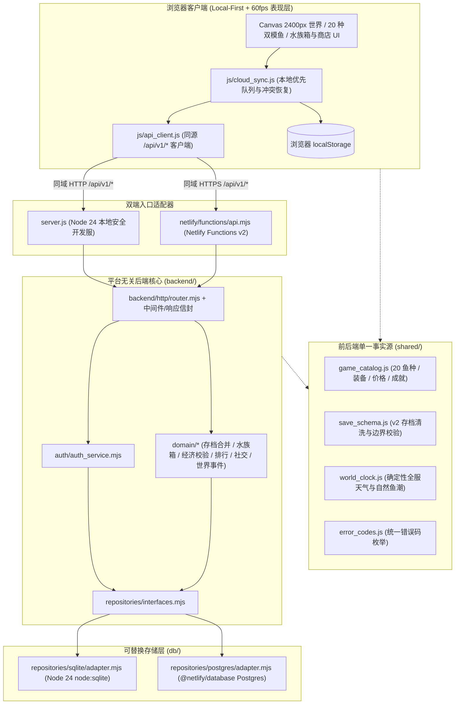
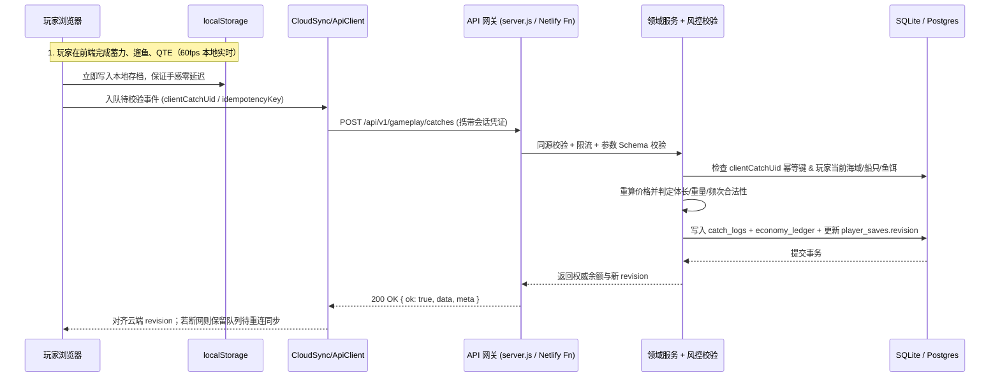
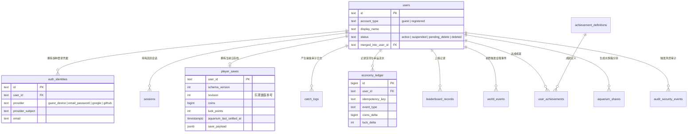

# 《微风垂钓物语 2.0》全栈工程架构总蓝图（GPT 审阅版）

> 本文档将分散在 [docs/](docs/README.md) 中的 7 份专题文档、数据库迁移 DDL、REST API 契约以及关键配置文件整合为一份**自包含单文件蓝图**，方便直接整体提交给外部评审模型（如 GPT）进行架构挑刺、风控漏洞审计与演进建议。

---

## 目录

1. [审阅导读与既定决策前提](#1-审阅导读与既定决策前提)
2. [重点邀请审阅者挑刺的 7 个高风险议题](#2-重点邀请审阅者挑刺的-7-个高风险议题)
3. [仓库目录结构与 M0 完整性状态矩阵](#3-仓库目录结构与-m0-完整性状态矩阵)
4. [系统分层架构与数据流](#4-系统分层架构与数据流)
5. [领域模型、混合权威与防作弊设计](#5-领域模型混合权威与防作弊设计)
6. [数据库设计（ER 图与完整 12 表 PostgreSQL DDL）](#6-数据库设计与完整-12-表-postgresql-ddl)
7. [REST API 全量契约（30 条路由与错误码表）](#7-rest-api-全量契约30-条路由与错误码表)
8. [安全防线与数据合规清单](#8-安全防线与数据合规清单)
9. [本地开发、线上部署与故障排查 Runbook](#9-本地开发线上部署与故障排查-runbook)
10. [分阶段实施路线图（M0 ~ M4）](#10-分阶段实施路线图m0--m4)
11. [附录：当前真实配置文件快照](#11-附录当前真实配置文件快照)

---

## 1. 审阅导读与既定决策前提

### 1.1 项目背景
- **产品形态**：《微风垂钓物语 2.0》（Whispering Waters Fishing）是一款原生 HTML5 Canvas + SVG + Tone.js 的 2D/2.5D 休闲垂钓网页游戏（2400px 4 大生态海域、20 种双模鱼类、性格化遛鱼与跃水 QTE、动态水族箱经营、码头悬赏订单、换装船坞）。
- **已确认的架构约束（A1 ~ A4）**：
  - **A1（运行架构）**：**核心解耦 + Netlify 全栈（Netlify Functions + Netlify Database Postgres）+ 本地 Node 24 原生 `node:sqlite` 镜像**。
  - **A2（权威边界）**：**混合权威完整版**——60fps 物理手操与画布渲染留在前端保证离线可玩与手感；云存档、离线水族箱收益、经济防作弊、多维排行榜、全服确定性天气/黄金鱼潮、成就与水族箱分享由后端负责。
  - **A3（账号体验）**：**游客免登录即玩 + 可选邮箱密码 / 第三方 OAuth 升级绑定**（绑定后自动合并游客/本地存档）。
  - **A4（当前阶段 M0）**：先建全项目架构蓝图、前后端单一事实源、数据库迁移、解耦后端契约骨架、构建/自检/测试与 CI，保持现有 10 个核心前端脚本**零破坏修改**。
- **环境现状**：
  - 线上静态站已绑定 Netlify；本机当前拥有 `Node.js v24.19.0`（支持原生 `node:sqlite`、`node:test`、`node:crypto`），但暂未安装 `npm`/Docker/本地 Postgres，因此 M0 基座脚本与本地运行服务必须做到**零外部 npm 依赖**。

---

## 2. 重点邀请审阅者挑刺的 7 个高风险议题

希望审阅模型（GPT）重点围绕以下 7 个具体工程/安全/业务痛点给出漏洞排查与改进意见：

1. **混合权威下的捕鱼防作弊漏洞（客户端抽鱼 vs 服务端抽鱼）**：
   - 当前 M0 规划把 60fps 抛竿/遛鱼/抽鱼保留在前端，服务端仅对 `POST /api/v1/gameplay/catches` 做“海域可达性、体长/重量区间、价值重算、鱼饵库存扣减、频率限制”校验。
   - **潜在风险**：恶意玩家虽然无法直接改出不存在的高价鱼，但能否通过修改前端 RNG 逻辑只上报“每次必中神话闪光极品体型鱼”？在不破坏离线可玩和 60fps 体验的前提下，是否应该引入**服务端预生成随机种子 / 渔获券（Cast Token）** 或 **稀有度分布统计异常检测（Chi-Square/滑动窗口检测）**？
2. **游客升级合并（Guest Merge）的刷币与刷榜套利风险**：
   - 当前设计允许游客先游玩再绑定或并入已有正式账号（`POST /api/v1/auth/upgrade` / `POST /api/v1/save/merge`）。
   - **潜在风险**：如果合并规则对金币、鱼饵或鱼篓直接叠加，攻击者可以不断用新游客号领取初始 `80 🪙 + 5 虫饵 + 1 金饵` 后并入主号；若仅取 `max()` 又可能让真实新设备玩家丢失刚钓到的资产。如何把“图鉴并集”和“货币/资产防重复注入”设计得既无漏洞又不伤正常玩家？
3. **Serverless 环境下内存限流器 (`createMemoryRateLimiter`) 的失效问题**：
   - 当前 `backend/http/middleware.mjs` 中仅定义了单实例内存滑窗限流器骨架。在 Netlify Functions 多实例并发与冷启动模式下，内存 Map 无法跨实例共享计数。
   - **审阅问题**：在 M1/M2 进入生产前，应如何在 Netlify Functions `config.rateLimit` 平台限流、Edge Functions 或 Postgres/Upstash 轻量计数器之间做分层防线？
4. **本地 `node:sqlite` 与线上 PostgreSQL 双端适配及迁移风控**：
   - 本地开发跑 SQLite (`TEXT` JSON)，线上跑 Postgres (`JSONB` + `BIGSERIAL` + `TIMESTAMPTZ`)。
   - **审阅问题**：手工同步维护 `db/migrations/sqlite/` 与 `db/migrations/postgres/` 两套 DDL 随迭代容易漂移；同时 Netlify Database 对 `netlify/database/migrations/` 实施严格 checksum 校验。是否有更好的迁移对齐校验或测试策略（例如 CI 自动比对两套表/列清单）？
5. **云存档乐观锁 (`409 SAVE_CONFLICT`) 与前端静默增量事件的交互时序**：
   - 玩家既可能直接操作“本地存档全量同步 (`PUT /api/v1/save`)”，又会在 M2 通过独立玩法接口（`POST /api/v1/gameplay/catches`、`claim-offline`）局部推进后端 `player_saves.revision`。
   - **审阅问题**：局部写接口推进 `revision` 后，若前端紧接着自动触发一次旧版本 `PUT /api/v1/save`，会频繁命中 `409 SAVE_CONFLICT`。如何清晰划分“M1 全量快照同步”与“M2 事件账本同步”的演进交接点，避免双写踩踏？
6. **CSP 与前端第三方 CDN 依赖的过渡安全性**：
   - 当前 `netlify.toml` 为兼容现有 `index.html` 的 Tailwind Play CDN、Tone.js CDN 与 Google Fonts，在 `Content-Security-Policy` 中开放了这些外部源及 `style-src 'unsafe-inline'`；同时部分接口若后续改用 HttpOnly Cookie 会话，需与 `verifySameOrigin()`（当前对无 `Origin` 请求放行）配合。
   - **审阅问题**：请从浏览器安全模型角度审视当前 `netlify.toml` 头配置与 `verifySameOrigin` 对“无 `Origin` 头请求”的边界处理（例如 `Sec-Fetch-Site` 检查与强制 CSRF Token）。
7. **未来迁出 Netlify 到独立容器/多人同屏实时服务的扩展成本**：
   - 当前所有业务放在 `backend/` 下，借助 Web 标准 `Request` / `Response` 运行；若未来需要增加 WebSocket 多人同屏钓鱼房间（如湖心岛共钓 + 实时弹幕），是否需要在 `backend/repositories` 与 `backend/domain` 之间进一步解耦事务边界（Unit of Work）与事件总线？

---

## 3. 仓库目录结构与 M0 完整性状态矩阵

### 3.1 当前目录树

```text
.
├── index.html                        # 游戏主页面与 5 大弹窗 UI (仅头部分增补 manifest 引用)
├── manifest.webmanifest              # PWA 基础清单
├── css/styles.css                    # 全局样式与动画
├── js/
│   ├── core.js                       # 4 海域、4 天气、运行时状态机
│   ├── fish_renderer.js              # 鱼类建模引擎与 2.5D 交互控制器
│   ├── fish_models_*.js              # 20 种鱼类独立 SVG/Canvas 模型 (4 文件)
│   ├── art_audio.js                  # 物种/装备目录与 Tone.js 声学系统
│   ├── scene_character.js            # 2400px 生态场景、角色与船只移动渲染
│   ├── gameplay_physics.js           # 概率引擎、遛鱼物理博弈、QTE 与飞鱼演出
│   ├── ui_aquarium.js                # 存档、鱼篓、互动水族箱、悬赏、图鉴与商店
│   ├── api_client.js                 # [M0 桩] 同源 /api/v1/* 请求客户端
│   └── cloud_sync.js                 # [M0 桩] 本地优先与云同步状态机
├── shared/                           # 前后端单一事实源 (UMD: 浏览器 + Node CJS/ESM)
│   ├── game_catalog.js               # 20 鱼种/海域/天气/鱼饵/装备/水族箱/12 成就目录
│   ├── save_schema.js                # v2 存档 Schema 与清洗边界校验
│   ├── world_clock.js                # 全服确定性天气与黄金鱼潮时钟
│   └── error_codes.js                # 统一错误码与 HTTP 状态映射
├── backend/                          # 平台无关后端核心 (纯 Node 24 ESM)
│   ├── config/env.mjs                # 读取 process.env / .env / Netlify.env
│   ├── observability/logger.mjs      # 单行结构化 JSON 日志 + 敏感字段自动脱敏
│   ├── auth/auth_service.mjs         # [M1 契约] 游客/邮箱/OAuth/升级合并/注销
│   ├── domain/                       # [M1~M3 契约] 存档/水族箱/防作弊/排行/世界/社交
│   ├── http/
│   │   ├── router.mjs                # Web 标准 Request/Response 路由器
│   │   ├── response.mjs              # 统一 JSON 信封与安全头
│   │   ├── middleware.mjs            # RequestId / 同源 CSRF / 鉴权解析 / 限流骨架
│   │   └── routes/*.mjs              # 7 个领域路由模块 (共 30 条路由)
│   └── repositories/
│       ├── interfaces.mjs            # 6 大仓储领域接口契约
│       ├── factory.mjs               # 按 STORAGE_DRIVER 切换 sqlite / postgres
│       ├── sqlite/adapter.mjs        # 本地 Node 24 node:sqlite 适配器 + 迁移器
│       └── postgres/adapter.mjs      # 线上 @netlify/database 动态导入适配器骨架
├── db/
│   ├── migrations/sqlite/0001_initial_schema.sql
│   ├── migrations/postgres/20261126000100_initial_schema.sql
│   └── seeds/0001_achievements_and_world.sql
├── netlify/
│   ├── functions/api.mjs             # Netlify Functions v2 (/api/*) 统一网关
│   └── database/README.md            # Netlify Database 迁移晋升与防 drift 指南
├── scripts/                          # build.mjs / db_migrate_local.mjs / verify.mjs
├── tests/                            # unit / contract / integration (node:test)
├── docs/                             # 拆分的 7 篇设计文档 + 索引
├── archive/cozy_fishing_game.html    # 早期单文件版本归档
├── dist/                             # 自动化构建的 Netlify 发布产物
├── server.js                         # 本地安全开发服务器 (静态白名单 + /api/* 代理)
├── netlify.toml                      # Netlify 构建、Functions 与安全/缓存头配置
├── package.json                      # 工程脚本与 Node >=24 声明
├── .env.example                      # 环境变量模板
└── .github/                          # CI 工作流与 PR 检查模板
```

### 3.2 模块落地状态矩阵

| 能力域 | 当前 (M0) 状态 | 对应文件 | 后续落地里程碑 |
| :--- | :--- | :--- | :--- |
| 前端单机 2.5D 垂钓玩法 | ✅ 完整可用（零改动） | `index.html`, `js/core.js` ~ `ui_aquarium.js` | M4 构建与离线优化 |
| 前后端单一事实源 (`shared/`) | ✅ 完整落地并有单元测试守护 | `shared/*.js` | 随数值迭代持续同步 |
| 12 表双端 DDL 与种子 | ✅ SQLite/Postgres 对齐并验证 | `db/` | M1 晋升 `netlify/database/` |
| 安全本地网关与 Netlify 入口 | ✅ `/api/*` 路由共享运行 | `server.js`, `netlify/functions/api.mjs` | M1 安装 `@netlify/*` |
| 健康检查与全服时钟接口 | ✅ 真实响应 `200 OK` | `routes/health.mjs`, `routes/world.mjs` | M3 叠加祈愿表查询 |
| 认证/云存档/经济/排行/分享 | 📐 接口契约桩 (`501`) + 领域接口 | `backend/auth/`, `backend/domain/`, `routes/` | M1 ~ M3 分批实现 |
| 构建/迁移/自检/测试/CI | ✅ 全绿运行 (15/15 测试通过) | `scripts/`, `tests/`, `.github/` | 随 M1 ~ M4 扩充 |

---

## 4. 系统分层架构与数据流

### 4.1 分层架构图



### 4.2 混合权威与云同步请求流



---

## 5. 领域模型、混合权威与防作弊设计

### 5.1 游客即玩与账号升级合并规则
1. **匿名游客开局**：首次联网同步时调用 `POST /api/v1/auth/guest` 签发高熵 `guestToken`，服务端在 `sessions` 与 `auth_identities(provider='guest_device')` 中仅存 SHA-256 哈希。
2. **原地升级为正式账号**：未绑定过正式身份的游客绑定邮箱或 OAuth 时，在同一 `user_id` 下将 `users.account_type` 变更为 `'registered'`，零数据迁移损耗。
3. **跨号合并（`SaveMergeService`）**：若游客记录并入一个已存在的正式账号，则原游客记录 `merged_into_user_id = targetUserId`，并按以下规则合并：
   - `records`（图鉴）：按 `fishId` 取并集，`maxKg` / `maxLen` 取最大值；
   - `unlockedBoats` / `unlockedHats` / `unlockedOutfits`：取集合并集；
   - `rodLevel` / `reelLevel` / `aquariumLevel`：取两者较高值；
   - 货币与背包：防止通过新建多个临时游客号合并刷取初始 80 金币，需控制游客合并额度并在 `economy_ledger` 记入 `save_merge_adjustment`。

### 5.2 云存档乐观锁 (`revision`) 与 Schema 边界
- `PUT /api/v1/save` 强制携带 `baseRevision`；若云端 `revision !== baseRevision` 返回 `409 SAVE_CONFLICT` 并附带最新云端版本，引导前端走 `POST /api/v1/save/merge`。
- 上传快照必须通过 [save_schema.js](file:///c:/Users/29616/Desktop/%E9%92%93%E9%B1%BC/shared/save_schema.js) 的 `sanitizeAndValidateSave`：验证等级上限 (`1..5`)、道具 ID 合法性、鱼篓/水族箱容量上限、未解锁船只禁止滞留深海坐标（`worldX > 1160` 自动重置至 `760`）。

### 5.3 水族箱离线门票结算公式
- 单鱼每分钟基础收益：`RARITIES[rarity].aquariumIncome * (isShiny ? 1.5 : 1.0)`（并与生长价值设封顶）。
- 展馆等级倍率：`AQUARIUM_UPGRADES[aquariumLevel].incomeMult`（1.0 / 1.25 / 1.55 / 1.90 / 2.50）。
- 离线有效时间：`clamp(serverNow - aquarium_last_settled_at, 0, OFFLINE_AQUARIUM_MAX_HOURS * 3600s)`（默认封顶 24 小时）。
- 领取接口强制使用 `Idempotency-Key` 并在数据库事务内推进 `aquarium_last_settled_at`。

### 5.4 混合权威防作弊矩阵

| 校验层 | 规则 | 触发动作 |
| :--- | :--- | :--- |
| 海域可达性 | 报告 `islet` (1200–1800) / `abyss` (1800–2400) 捕鱼必须已解锁非 `'none'` 船只 | `422 ANTICHEAT_REJECTED` |
| 物种数值边界 | `fishId` 存在、`lengthCm`/`weightKg` 在物种物理合理边界内 | `validation_status='rejected'` + 安全日志 |
| 价格服务端重算 | 忽略客户端售价，按基准价值、体型因子、Shiny 与服务端实时鱼潮重新计算 | 防止改包刷币 |
| 鱼饵库存校验 | 消耗 `worm`/`gold`/`star` 时在事务内原子扣减库存 | 库存不足拒绝高阶增益 |
| 频次速率风控 | 单位时间内连续上报超物理极限频次渔获 | 标为 `flagged`，不进入公开榜单 |
| 榜单审核隔离 | `leaderboard_records` 查询仅返回 `audit_status = 'verified'` | 保证榜单公信力 |

### 5.5 确定性全服天气与黄金鱼潮时钟
- 由 [world_clock.js](file:///c:/Users/29616/Desktop/%E9%92%93%E9%B1%BC/shared/world_clock.js) 基于 UTC 时间戳与 `WORLD_CLOCK_SEED` 无状态计算：
  - 天气每 **15 分钟** 轮换（FNV-1a 32 位哈希映射到 `sunny` 45%、`rain` 27%、`storm` 16%、`meteor` 12%）；
  - 自然黄金鱼潮每 **60 分钟** 确定性出现 **3 分钟**；
  - M3 玩家祈愿召唤的 **60 秒** 黄金鱼潮写入 `world_events`，查询 `/api/v1/world/state` 时取自然窗口与祈愿窗口的最晚结束时间对外广播。

---

## 6. 数据库设计与完整 12 表 PostgreSQL DDL

### 6.1 核心实体关系图 (ER Diagram)



### 6.2 完整生产 PostgreSQL 建表脚本（`db/migrations/postgres/20261126000100_initial_schema.sql`）

> 本地开发目录 `db/migrations/sqlite/0001_initial_schema.sql` 保持与以下 DDL 1:1 语义对齐（使用 `INTEGER` 布尔/`TEXT` ISO 时间与 JSON）。

```sql
-- 1. 玩家主表 (支持游客与正式账号平滑升级)
CREATE TABLE IF NOT EXISTS users (
  id TEXT PRIMARY KEY,
  account_type TEXT NOT NULL CHECK (account_type IN ('guest', 'registered')),
  display_name TEXT NOT NULL,
  avatar_frame TEXT NOT NULL DEFAULT 'straw',
  status TEXT NOT NULL DEFAULT 'active' CHECK (status IN ('active', 'suspended', 'pending_delete', 'deleted')),
  role TEXT NOT NULL DEFAULT 'player' CHECK (role IN ('player', 'moderator', 'admin')),
  merged_into_user_id TEXT REFERENCES users(id) ON DELETE SET NULL,
  created_at TIMESTAMPTZ NOT NULL DEFAULT NOW(),
  updated_at TIMESTAMPTZ NOT NULL DEFAULT NOW(),
  deleted_at TIMESTAMPTZ
);

CREATE INDEX IF NOT EXISTS idx_users_status ON users(status);
CREATE INDEX IF NOT EXISTS idx_users_merged_into ON users(merged_into_user_id);

-- 2. 多重认证凭据表 (游客令牌 / 邮箱密码 / 第三方 OAuth 解耦绑定)
CREATE TABLE IF NOT EXISTS auth_identities (
  id TEXT PRIMARY KEY,
  user_id TEXT NOT NULL REFERENCES users(id) ON DELETE CASCADE,
  provider TEXT NOT NULL CHECK (provider IN ('guest_device', 'email_password', 'google', 'github')),
  provider_subject TEXT NOT NULL,
  email TEXT,
  email_verified BOOLEAN NOT NULL DEFAULT FALSE,
  password_hash TEXT,
  last_used_at TIMESTAMPTZ,
  created_at TIMESTAMPTZ NOT NULL DEFAULT NOW(),
  UNIQUE (provider, provider_subject)
);

CREATE INDEX IF NOT EXISTS idx_auth_identities_user_id ON auth_identities(user_id);
CREATE UNIQUE INDEX IF NOT EXISTS idx_auth_identities_email_unique
  ON auth_identities(LOWER(email))
  WHERE email IS NOT NULL AND provider = 'email_password';

-- 3. 会话令牌表 (仅存 Token SHA-256 哈希，绝不存明文会话密钥)
CREATE TABLE IF NOT EXISTS sessions (
  id TEXT PRIMARY KEY,
  user_id TEXT NOT NULL REFERENCES users(id) ON DELETE CASCADE,
  token_hash TEXT NOT NULL UNIQUE,
  device_label TEXT,
  ip_hash TEXT,
  user_agent TEXT,
  expires_at TIMESTAMPTZ NOT NULL,
  revoked_at TIMESTAMPTZ,
  created_at TIMESTAMPTZ NOT NULL DEFAULT NOW(),
  last_seen_at TIMESTAMPTZ NOT NULL DEFAULT NOW()
);

CREATE INDEX IF NOT EXISTS idx_sessions_user_id ON sessions(user_id);
CREATE INDEX IF NOT EXISTS idx_sessions_expires_at ON sessions(expires_at);

-- 4. 云存档快照表 (JSONB 载荷 + 乐观锁 revision + 水族箱离线结算时间戳)
CREATE TABLE IF NOT EXISTS player_saves (
  user_id TEXT PRIMARY KEY REFERENCES users(id) ON DELETE CASCADE,
  schema_version INTEGER NOT NULL DEFAULT 2 CHECK (schema_version >= 1),
  revision INTEGER NOT NULL DEFAULT 1 CHECK (revision >= 1),
  coins BIGINT NOT NULL DEFAULT 80 CHECK (coins >= 0),
  luck_points INTEGER NOT NULL DEFAULT 0 CHECK (luck_points >= 0),
  aquarium_level INTEGER NOT NULL DEFAULT 1 CHECK (aquarium_level BETWEEN 1 AND 5),
  aquarium_last_settled_at TIMESTAMPTZ NOT NULL DEFAULT NOW(),
  species_unlocked_count INTEGER NOT NULL DEFAULT 0 CHECK (species_unlocked_count >= 0),
  total_catches INTEGER NOT NULL DEFAULT 0 CHECK (total_catches >= 0),
  save_payload JSONB NOT NULL,
  payload_checksum TEXT NOT NULL,
  updated_at TIMESTAMPTZ NOT NULL DEFAULT NOW()
);

CREATE INDEX IF NOT EXISTS idx_player_saves_updated_at ON player_saves(updated_at DESC);

-- 5. 渔获防作弊审计流水表 (支持 client_catch_uid 幂等去重)
CREATE TABLE IF NOT EXISTS catch_logs (
  id BIGSERIAL PRIMARY KEY,
  user_id TEXT NOT NULL REFERENCES users(id) ON DELETE CASCADE,
  client_catch_uid TEXT NOT NULL,
  fish_id TEXT NOT NULL,
  rarity TEXT NOT NULL CHECK (rarity IN ('common', 'rare', 'epic', 'legendary', 'mythic')),
  biome_id TEXT NOT NULL,
  depth_zone INTEGER NOT NULL CHECK (depth_zone BETWEEN 0 AND 2),
  bait_id TEXT NOT NULL,
  weather_id TEXT NOT NULL,
  is_golden_tide BOOLEAN NOT NULL DEFAULT FALSE,
  is_shiny BOOLEAN NOT NULL DEFAULT FALSE,
  length_cm DOUBLE PRECISION NOT NULL CHECK (length_cm > 0),
  weight_kg DOUBLE PRECISION NOT NULL CHECK (weight_kg > 0),
  computed_value INTEGER NOT NULL CHECK (computed_value >= 0),
  disposition TEXT NOT NULL DEFAULT 'pending' CHECK (disposition IN ('pending', 'sold', 'aquarium', 'basket', 'released', 'order')),
  validation_status TEXT NOT NULL DEFAULT 'verified' CHECK (validation_status IN ('verified', 'flagged', 'rejected')),
  validation_reason TEXT,
  caught_at TIMESTAMPTZ NOT NULL,
  created_at TIMESTAMPTZ NOT NULL DEFAULT NOW(),
  UNIQUE (user_id, client_catch_uid)
);

CREATE INDEX IF NOT EXISTS idx_catch_logs_user_caught ON catch_logs(user_id, caught_at DESC);
CREATE INDEX IF NOT EXISTS idx_catch_logs_fish_weight ON catch_logs(fish_id, weight_kg DESC);

-- 6. 经济账本流水表 (只追加 Append-Only)
CREATE TABLE IF NOT EXISTS economy_ledger (
  id BIGSERIAL PRIMARY KEY,
  user_id TEXT NOT NULL REFERENCES users(id) ON DELETE CASCADE,
  idempotency_key TEXT NOT NULL,
  event_type TEXT NOT NULL CHECK (
    event_type IN (
      'catch_sell',
      'catch_release',
      'aquarium_offline_claim',
      'aquarium_feed',
      'aquarium_upgrade',
      'shop_purchase',
      'bounty_deliver',
      'golden_tide_summon',
      'achievement_claim',
      'save_merge_adjustment'
    )
  ),
  coins_delta BIGINT NOT NULL DEFAULT 0,
  luck_delta INTEGER NOT NULL DEFAULT 0,
  coins_after BIGINT NOT NULL CHECK (coins_after >= 0),
  luck_after INTEGER NOT NULL CHECK (luck_after >= 0),
  reference_id TEXT,
  metadata_json JSONB NOT NULL DEFAULT '{}'::jsonb,
  created_at TIMESTAMPTZ NOT NULL DEFAULT NOW(),
  UNIQUE (user_id, idempotency_key)
);

CREATE INDEX IF NOT EXISTS idx_economy_ledger_user_created ON economy_ledger(user_id, created_at DESC);

-- 7. 多维度排行榜聚合表
CREATE TABLE IF NOT EXISTS leaderboard_records (
  id BIGSERIAL PRIMARY KEY,
  user_id TEXT NOT NULL REFERENCES users(id) ON DELETE CASCADE,
  board_type TEXT NOT NULL CHECK (board_type IN ('species_weight', 'species_length', 'encyclopedia', 'wealth', 'bounty_master')),
  scope_key TEXT NOT NULL DEFAULT 'global',
  score_numeric DOUBLE PRECISION NOT NULL DEFAULT 0,
  display_name_snapshot TEXT NOT NULL,
  is_shiny BOOLEAN NOT NULL DEFAULT FALSE,
  metadata_json JSONB NOT NULL DEFAULT '{}'::jsonb,
  audit_status TEXT NOT NULL DEFAULT 'verified' CHECK (audit_status IN ('verified', 'flagged', 'rejected')),
  achieved_at TIMESTAMPTZ NOT NULL DEFAULT NOW(),
  updated_at TIMESTAMPTZ NOT NULL DEFAULT NOW(),
  UNIQUE (user_id, board_type, scope_key)
);

CREATE INDEX IF NOT EXISTS idx_leaderboard_rank
  ON leaderboard_records(board_type, scope_key, audit_status, score_numeric DESC, achieved_at ASC);

-- 8. 全服祈愿事件记录表
CREATE TABLE IF NOT EXISTS world_events (
  id TEXT PRIMARY KEY,
  event_type TEXT NOT NULL CHECK (event_type IN ('golden_tide_summon', 'system_weather_override')),
  triggered_by_user_id TEXT REFERENCES users(id) ON DELETE SET NULL,
  payload_json JSONB NOT NULL DEFAULT '{}'::jsonb,
  starts_at TIMESTAMPTZ NOT NULL,
  ends_at TIMESTAMPTZ NOT NULL,
  created_at TIMESTAMPTZ NOT NULL DEFAULT NOW()
);

CREATE INDEX IF NOT EXISTS idx_world_events_active ON world_events(event_type, ends_at DESC);

-- 9. 成就定义目录表
CREATE TABLE IF NOT EXISTS achievement_definitions (
  code TEXT PRIMARY KEY,
  title TEXT NOT NULL,
  description TEXT NOT NULL,
  category TEXT NOT NULL,
  target_value INTEGER NOT NULL DEFAULT 1 CHECK (target_value >= 1),
  reward_coins INTEGER NOT NULL DEFAULT 0 CHECK (reward_coins >= 0),
  reward_luck INTEGER NOT NULL DEFAULT 0 CHECK (reward_luck >= 0),
  sort_order INTEGER NOT NULL DEFAULT 0
);

-- 10. 玩家成就进度与领奖表
CREATE TABLE IF NOT EXISTS user_achievements (
  user_id TEXT NOT NULL REFERENCES users(id) ON DELETE CASCADE,
  achievement_code TEXT NOT NULL REFERENCES achievement_definitions(code) ON DELETE CASCADE,
  progress_value INTEGER NOT NULL DEFAULT 0 CHECK (progress_value >= 0),
  unlocked_at TIMESTAMPTZ,
  claimed_at TIMESTAMPTZ,
  PRIMARY KEY (user_id, achievement_code)
);

-- 11. 水族箱只读分享卡片表
CREATE TABLE IF NOT EXISTS aquarium_shares (
  id TEXT PRIMARY KEY,
  share_code TEXT NOT NULL UNIQUE,
  user_id TEXT NOT NULL REFERENCES users(id) ON DELETE CASCADE,
  title TEXT NOT NULL,
  owner_display_name TEXT NOT NULL,
  aquarium_level INTEGER NOT NULL CHECK (aquarium_level BETWEEN 1 AND 5),
  snapshot_json JSONB NOT NULL,
  likes_count INTEGER NOT NULL DEFAULT 0 CHECK (likes_count >= 0),
  views_count INTEGER NOT NULL DEFAULT 0 CHECK (views_count >= 0),
  is_public BOOLEAN NOT NULL DEFAULT TRUE,
  expires_at TIMESTAMPTZ,
  created_at TIMESTAMPTZ NOT NULL DEFAULT NOW(),
  updated_at TIMESTAMPTZ NOT NULL DEFAULT NOW()
);

CREATE INDEX IF NOT EXISTS idx_aquarium_shares_user ON aquarium_shares(user_id, created_at DESC);

-- 12. 安全与风控审计日志表
CREATE TABLE IF NOT EXISTS audit_security_events (
  id BIGSERIAL PRIMARY KEY,
  user_id TEXT REFERENCES users(id) ON DELETE SET NULL,
  event_category TEXT NOT NULL,
  severity TEXT NOT NULL CHECK (severity IN ('info', 'warn', 'high', 'critical')),
  ip_hash TEXT,
  request_id TEXT,
  details_json JSONB NOT NULL DEFAULT '{}'::jsonb,
  created_at TIMESTAMPTZ NOT NULL DEFAULT NOW()
);

CREATE INDEX IF NOT EXISTS idx_audit_security_created ON audit_security_events(created_at DESC);
CREATE INDEX IF NOT EXISTS idx_audit_security_user ON audit_security_events(user_id, created_at DESC);
```

---

## 7. REST API 全量契约（30 条路由与错误码表）

### 7.1 统一响应信封与请求头
- **认证头**：`Authorization: Bearer <sessionToken>` 或 `X-Guest-Token: <guestToken>`
- **幂等键**：`Idempotency-Key: <uuid>`（写账本及非幂等 `POST` 必传）
- **成功信封**：`{ "ok": true, "data": { ... }, "meta": { "requestId": "req_...", "serverTime": "..." } }`
- **错误信封**：`{ "ok": false, "error": { "code": "...", "message": "...", "details": { ... } }, "meta": { "requestId": "...", "serverTime": "..." } }`

### 7.2 全量 30 条路由清单

| 领域 | 方法与路径 | 当前状态 | 鉴权 / 幂等 | 核心说明 |
| :--- | :--- | :--- | :--- | :--- |
| **系统** | `GET /api/v1/health` | `LIVE (M0)` | 公开 | 服务健康、目录版本、存储健康探针与功能开关 |
| **世界** | `GET /api/v1/world/state` | `LIVE (M0)` | 公开 | 确定性全服天气周期、下期天气与黄金鱼潮倒计时 |
| **世界** | `POST /api/v1/world/golden-tide/summon` | `STUB (M3)` | 需鉴权 + 幂等 | 消耗 8 幸运或 180 金币召唤 60 秒全服黄金鱼潮 |
| **认证** | `POST /api/v1/auth/guest` | `STUB (M1)` | 公开 | 签发游客账号与高熵设备令牌 |
| **认证** | `POST /api/v1/auth/register` | `STUB (M1)` | 公开 | 邮箱注册，支持附带游客令牌无损升级 |
| **认证** | `POST /api/v1/auth/login` | `STUB (M1)` | 公开 | 邮箱密码登录并签发会话 |
| **认证** | `POST /api/v1/auth/logout` | `STUB (M1)` | 需鉴权 + 幂等 | 吊销当前会话 |
| **认证** | `POST /api/v1/auth/upgrade` | `STUB (M1)` | 需鉴权 | 游客账号原地绑定邮箱或第三方 OAuth 并合并存档 |
| **认证** | `GET /api/v1/auth/me` | `STUB (M1)` | 需鉴权 | 获取当前用户信息与绑定凭据摘要 |
| **认证** | `DELETE /api/v1/auth/account` | `STUB (M1)` | 需鉴权 + 幂等 | 合规账号注销与个人数据清理 |
| **认证** | `GET /api/v1/auth/oauth/:provider` | `STUB (M1)` | 公开 | 第三方 OAuth 跳转 (`google` / `github`) |
| **存档** | `GET /api/v1/save` | `STUB (M1)` | 需鉴权 | 拉取云端快照、`revision` 与待结算离线收益预估 |
| **存档** | `PUT /api/v1/save` | `STUB (M1)` | 需鉴权 + 幂等 | 带 `baseRevision` 乐观锁保存；过期返回 `409 SAVE_CONFLICT` |
| **存档** | `POST /api/v1/save/merge` | `STUB (M1)` | 需鉴权 | 冲突恢复与多端安全并集合并 |
| **存档** | `GET /api/v1/save/export` | `STUB (M1)` | 需鉴权 | 导出带校验的个人 JSON 存档包 |
| **存档** | `POST /api/v1/save/import` | `STUB (M1)` | 需鉴权 | 校验并导入存档包 |
| **玩法** | `POST /api/v1/gameplay/catches` | `STUB (M2)` | 需鉴权 + 幂等 | 上报捕鱼明细与处置，服务端做风控校验与价格重算 |
| **玩法** | `POST /api/v1/gameplay/shop/purchase` | `STUB (M2)` | 需鉴权 + 幂等 | 购买鱼饵/钓竿/卷线器/船只/服饰，权威扣款 |
| **玩法** | `POST /api/v1/gameplay/orders/deliver` | `STUB (M2)` | 需鉴权 + 幂等 | 交付码头悬赏订单并原子发赏 |
| **玩法** | `POST /api/v1/gameplay/aquarium/claim-offline` | `STUB (M2)` | 需鉴权 + 幂等 | 按 UTC 时间差结算离线水族箱门票（封顶 24 小时） |
| **玩法** | `POST /api/v1/gameplay/aquarium/feed` | `STUB (M2)` | 需鉴权 + 幂等 | 扣除 15 金币使展馆鱼全员体型与价值 +8% |
| **玩法** | `POST /api/v1/gameplay/aquarium/upgrade` | `STUB (M2)` | 需鉴权 + 幂等 | 扩建水族箱等级 (1..5) |
| **排行** | `GET /api/v1/leaderboards/me` | `STUB (M3)` | 需鉴权 | 本人各榜当前排名与最佳记录 |
| **排行** | `GET /api/v1/leaderboards/species/:fishId` | `STUB (M3)` | 公开 | 单鱼种最重/最长排行榜 |
| **排行** | `GET /api/v1/leaderboards/:boardType` | `STUB (M3)` | 公开 | 综合榜 (`encyclopedia` / `wealth` / `bounty_master`) |
| **成就** | `GET /api/v1/achievements` | `STUB (M3)` | 需鉴权 | 查询 12 项里程碑成就进度 |
| **成就** | `POST /api/v1/achievements/:code/claim` | `STUB (M3)` | 需鉴权 + 幂等 | 领取已解锁成就奖励 |
| **分享** | `POST /api/v1/aquarium/shares` | `STUB (M3)` | 需鉴权 | 生成水族箱只读公开分享码 |
| **分享** | `GET /api/v1/aquarium/shares/:shareCode` | `STUB (M3)` | 公开 | 浏览分享的水族箱快照 |
| **分享** | `POST /api/v1/aquarium/shares/:shareCode/like` | `STUB (M3)` | 公开 + 幂等 | 点赞分享卡片 |

### 7.3 统一错误码表（`shared/error_codes.js`）
- `OK` (`200`) / `VALIDATION_ERROR` (`400`) / `UNAUTHORIZED` (`401`) / `FORBIDDEN` (`403`) / `NOT_FOUND` (`404`) / `METHOD_NOT_ALLOWED` (`405`) / `SAVE_CONFLICT` (`409`) / `IDEMPOTENCY_CONFLICT` (`409`) / `ANTICHEAT_REJECTED` (`422`) / `RATE_LIMITED` (`429`) / `INTERNAL_ERROR` (`500`) / `NOT_IMPLEMENTED` (`501`)

---

## 8. 安全防线与数据合规清单

1. **凭据与日志安全**：
   - M1 密码强制采用 `crypto.scrypt` + `crypto.timingSafeEqual`；
   - `sessions.token_hash` 仅存 SHA-256 哈希；
   - `backend/observability/logger.mjs` 自动递归将 `password`/`secret`/`token`/`authorization`/`cookie` 键替换为 `[REDACTED]`。
2. **输入、CSRF 与限流**：
   - `server.js` 静态服务采用显式白名单 (`/`, `/index.html`, `/manifest.webmanifest`, `/css/*`, `/js/*`, `/shared/*`) + `path.resolve` 前缀断言，拒绝 `..`、`.env`、`.git/`、`backend/`、`db/`、`data/`；
   - API 请求体限制 `2 MB`；状态变更方法经过 `verifySameOrigin()`；
   - `SaveSchema` 拷贝清洗并拦截越界值与原型污染。
3. **响应头与安全演化**：
   - 所有静态与 API 响应均带 `X-Content-Type-Options: nosniff`、`X-Frame-Options: DENY`、`Referrer-Policy: strict-origin-when-cross-origin`；
   - 计划于 M4 将 Tailwind CSS 构建为本地 CSS 并本地托管 Tone.js，收紧 CSP 去除外链 CDN 与 `style-src 'unsafe-inline'`。
4. **合规设计**：支持免邮箱游客模式、个人存档 JSON 导出 (`GET /api/v1/save/export`) 与账号注销清理 (`DELETE /api/v1/auth/account`)。

---

## 9. 本地开发、线上部署与故障排查 Runbook

- **本地零依赖运行（Node 24+）**：
  - `node scripts/db_migrate_local.mjs`（初始化本地 SQLite）
  - `node scripts/build.mjs`（同步构建 `dist/`）
  - `node server.js`（启动 `http://127.0.0.1:18888/index.html` 与 `/api/v1/*`）
  - `node scripts/verify.mjs`（50 项必需路径 + 49 个 JS/MJS 语法 + `dist/` 哈希对齐 + 内存 SQLite 建库自检）
  - `node --test tests/unit/*.test.mjs tests/contract/*.test.mjs tests/integration/*.test.mjs`（15 项自动化测试）
- **线上 Netlify 部署注意事项**：
  - 当前 `db/migrations/postgres/` 尚未晋升至 `netlify/database/migrations/`，待 M1 安装 `@netlify/functions` 与 `@netlify/database` 后按 [netlify/database/README.md](netlify/database/README.md) 晋升；
  - 已部署的迁移文件**禁止修改或删除**，以免触发 Netlify checksum drift 部署失败；
  - 全部敏感变量（`AUTH_SESSION_SECRET`、`AUTH_GUEST_TOKEN_SECRET`、`NETLIFY_DB_URL`、OAuth Secrets）只放 Netlify Secrets。

---

## 10. 分阶段实施路线图（M0 ~ M4）

- **M0（已完成 ✅）**：全套蓝图文档、共享契约、双端 DDL 与种子、解耦后端与网关骨架、构建/自检/测试/CI，保持单机版 100% 完整可玩。
- **M1（认证与云存档闭环）**：落地 `users/auth_identities/sessions/player_saves` 仓储、`scrypt` 注册登录、游客升级绑定、乐观锁 `409` 与合并、前端 `CloudSync` 启用。
- **M2（混合权威经济与离线水族箱）**：落地捕鱼校验、价格重算、`economy_ledger` 幂等流水、UTC 离线水族箱收益与异常 `flagged` 审计。
- **M3（全服事件与社交扩展）**：落地祈愿黄金鱼潮持久化、5 维排行榜（仅展示 `verified`）、12 项成就领奖与水族箱公开分享卡片。
- **M4（工程化生产优化）**：Tailwind CSS 本地编译与离线资源托管、收紧 CSP、Service Worker 离线缓存与线上可观测告警。

---

## 11. 附录：当前真实配置文件快照

### 11.1 `netlify.toml`

```toml
"$schema" = "https://open-api.netlify.com/netlify.schema.json"

[build]
  publish = "dist"
  command = "node scripts/build.mjs"

[build.environment]
  NODE_VERSION = "24"

[functions]
  directory = "netlify/functions"
  node_bundler = "esbuild"

[[headers]]
  for = "/*"
  [headers.values]
    X-Content-Type-Options = "nosniff"
    X-Frame-Options = "DENY"
    Referrer-Policy = "strict-origin-when-cross-origin"
    Permissions-Policy = "camera=(), microphone=(), geolocation=()"
    Content-Security-Policy = '''
      default-src 'self';
      script-src 'self' https://cdn.tailwindcss.com https://cdnjs.cloudflare.com;
      style-src 'self' 'unsafe-inline' https://fonts.googleapis.com;
      font-src 'self' https://fonts.gstatic.com data:;
      img-src 'self' data: blob:;
      connect-src 'self';
      worker-src 'self' blob:;
      object-src 'none';
      base-uri 'self';
      frame-ancestors 'none';
    '''

[[headers]]
  for = "/index.html"
  [headers.values]
    Cache-Control = "no-cache"

[[headers]]
  for = "/manifest.webmanifest"
  [headers.values]
    Content-Type = "application/manifest+json; charset=utf-8"
    Cache-Control = "public, max-age=3600"

[[headers]]
  for = "/css/*"
  [headers.values]
    Cache-Control = "public, max-age=3600"

[[headers]]
  for = "/js/*"
  [headers.values]
    Cache-Control = "public, max-age=3600"

[[headers]]
  for = "/shared/*"
  [headers.values]
    Cache-Control = "public, max-age=3600"
```

### 11.2 `package.json`

```json
{
  "name": "whispering-waters-fishing",
  "version": "2.1.0-foundation",
  "description": "《微风垂钓物语 2.0》：原生 Canvas/SVG 休闲垂钓网页游戏与核心解耦的全栈工程基座",
  "private": true,
  "engines": {
    "node": ">=24.0.0"
  },
  "scripts": {
    "dev": "node server.js",
    "build": "node scripts/build.mjs",
    "verify": "node scripts/verify.mjs",
    "test": "node --test tests/unit/*.test.mjs tests/contract/*.test.mjs tests/integration/*.test.mjs",
    "db:migrate:local": "node scripts/db_migrate_local.mjs"
  },
  "keywords": [
    "fishing-game",
    "html5-canvas",
    "svg",
    "netlify-functions",
    "sqlite",
    "postgres"
  ],
  "license": "UNLICENSED"
}
```

### 11.3 `.env.example`

```dotenv
NODE_ENV=development
APP_ENV=local
PORT=18888
HOST=127.0.0.1

STORAGE_DRIVER=sqlite
SQLITE_DB_PATH=./data/whispering_waters.sqlite
NETLIFY_DB_URL=

AUTH_SESSION_SECRET=replace-with-local-dev-session-secret-min-32-chars
AUTH_GUEST_TOKEN_SECRET=replace-with-local-dev-guest-secret-min-32-chars
SESSION_TTL_DAYS=30
CORS_ALLOWED_ORIGINS=http://localhost:18888,http://127.0.0.1:18888

OAUTH_GOOGLE_CLIENT_ID=
OAUTH_GITHUB_CLIENT_ID=

RATE_LIMIT_WINDOW_SEC=60
RATE_LIMIT_MAX_REQ=120

WORLD_CLOCK_SEED=wwf-v2-global
OFFLINE_AQUARIUM_MAX_HOURS=24

FEATURE_CLOUD_SYNC=false
FEATURE_LEADERBOARDS=false
FEATURE_SOCIAL_SHARES=false
```
