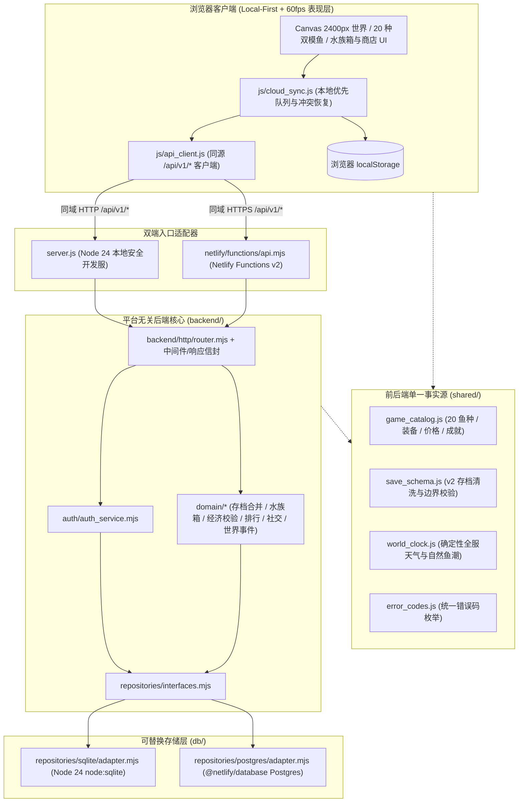
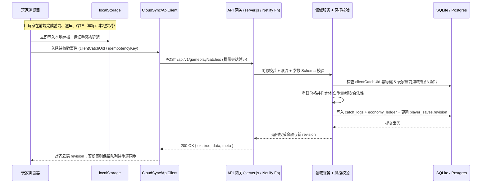

# 01. 系统架构与核心解耦设计

## 1. 设计目标与架构选型

《微风垂钓物语 2.0》采用 **“核心解耦 + Netlify 全栈 + 本地 Node 24/SQLite 镜像”** 混合权威架构：

1. **体验不妥协**：60fps 2.5D 角色划船/转身物理、8 阶段抛竿/咬钩/遛鱼博弈、Tone.js 程序化声学和 Canvas/SVG 双模鱼类渲染全部保留在浏览器端，**断网或后端维护时仍可单机畅玩**。
2. **核心与平台彻底解耦**：所有 HTTP 路由、鉴权、云存档合并、经济防作弊和世界时钟均写在平台无关的 `backend/`（基于 Web 标准 `Request` / `Response`）；`netlify/functions/api.mjs` 与本地 `server.js` 仅作为入口适配器。
3. **本地零依赖、线上零运维**：
   - 本地开发直接利用 `Node.js 24` 原生 `node:sqlite` 与 `node:test`，无需安装 Docker 或本地 PostgreSQL 即可做完整联调；
   - 线上通过 Netlify Functions + Netlify Database (PostgreSQL) 与静态前端同域部署，彻底免除 CORS 跨域和自建运维负担。
4. **平滑演进退路**：若未来需要独立云服务器或 WebSocket 多人同屏实时钓场，只需新增一个独立 Node HTTP/WS 入口挂载 `backend/http/router.mjs` 和领域服务即可，无需重写业务逻辑。

---

## 2. 整体分层架构图

---

## 3. 核心请求数据流（云同步与混合权威）

---

## 4. 前后端职责清晰边界

| 能力模块 | 前端职责 (`js/`) | 共享契约 (`shared/`) | 后端职责 (`backend/`) |
| :--- | :--- | :--- | :--- |
| **移动与物理手感** | 角色/船只插值、浮漂抛物线、QTE 判定、Canvas/SVG 渲染 | 世界宽度 `2400`、海域坐标区间 | 仅校验上报捕鱼时所在海域是否合法（如深水需船） |
| **抽鱼与鱼类生成** | 客户端按权重大致体验出鱼节奏，支持离线单机游玩 | 20 鱼种基础权重、体长/重量上下界、稀有度倍率 | 接收捕鱼记录后做合理性边界复核并按基准公式重算售价 |
| **经济与道具升级** | UI 展示价格与即时响应反馈 | 鱼饵/钓竿/卷线器/船只/服装/水族箱价格目录 | 服务端权威扣款、防负余额、防重放幂等与流水记账 |
| **水族箱收益** | 弹窗内实时互动喂食、气泡、游动演出 | 稀有度基础每分钟门票、等级容量与收益倍数 | 服务端以 UTC 时间差结算离线门票（封顶 24 小时） |
| **存档与账号** | `localStorage` 本地首写、登录后触发合并向导 | `SaveSchema v2` 结构、清洗与边界规则 | 会话管理、密码哈希、游客合并、`revision` 乐观锁 |
| **全服天气与鱼潮** | 渲染天气粒子与黄金鱼潮视觉效果 | `world_clock.js` 确定性 UTC 算法 | 返回全服时钟并与数据库祈愿 `world_events` 叠加 |
