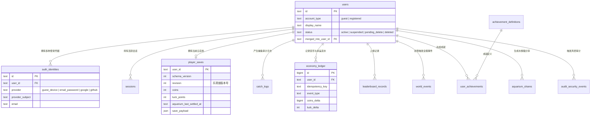

# 03. 数据库设计与双端迁移规范

## 1. 设计原则

- **本地/线上语义 1:1 镜像**：本地开发使用 Node 24 原生 `node:sqlite` (`db/migrations/sqlite/0001_initial_schema.sql`)，线上使用 Netlify Database PostgreSQL (`db/migrations/postgres/20261126000100_initial_schema.sql`)。
- **财务级幂等与不可篡改账本**：涉及捕鱼收益、离线门票、商店购买、悬赏交付的全部货币变动，都必须写入只追加的 `economy_ledger` 表并通过 `(user_id, idempotency_key)` 唯一约束防止重复扣款或刷钱。
- **零明文凭据存储**：会话令牌仅存 `token_hash`（SHA-256），密码仅存 `scrypt` 盐值哈希。

---

## 2. 实体关系图 (ER Diagram)

---

## 3. 核心表清单（12 张业务表）

| 表名 | 核心用途 | 关键唯一/索引约束 |
| :--- | :--- | :--- |
| `users` | 玩家主体信息、游客/正式区分、合号指向与注销状态 | `PRIMARY KEY (id)`, `idx_users_status` |
| `auth_identities` | 多凭据解耦绑定（游客设备、邮箱密码、OAuth） | `UNIQUE (provider, provider_subject)`, 部分唯一索引 `email` |
| `sessions` | 登录会话与失效控制（存 `token_hash`） | `UNIQUE (token_hash)`, `idx_sessions_user_id` |
| `player_saves` | 云存档 JSON、乐观锁 `revision`、离线结算时间基线 | `PRIMARY KEY (user_id)`, `CHECK (revision >= 1)` |
| `catch_logs` | 捕鱼明细与风控审核状态 (`verified/flagged/rejected`) | `UNIQUE (user_id, client_catch_uid)`, `idx_catch_logs_fish_weight` |
| `economy_ledger` | 只追加经济账本流水（防刷钱与对账依据） | `UNIQUE (user_id, idempotency_key)`, `idx_economy_ledger_user_created` |
| `leaderboard_records` | 5 大榜单聚合表（单种最重/最长、图鉴、财富、悬赏） | `UNIQUE (user_id, board_type, scope_key)` + 排位复合索引 |
| `world_events` | 全服祈愿黄金鱼潮等动态事件窗口 | `idx_world_events_active (event_type, ends_at DESC)` |
| `achievement_definitions` | 12 项里程碑成就定义目录（由种子 SQL 幂等填充） | `PRIMARY KEY (code)` |
| `user_achievements` | 玩家各成就进度、解锁与领奖时间戳 | `PRIMARY KEY (user_id, achievement_code)` |
| `aquarium_shares` | 个人水族箱快照只读分享码、浏览与点赞计数 | `UNIQUE (share_code)`, `idx_aquarium_shares_user` |
| `audit_security_events` | 安全事件与异常告警流水 | `idx_audit_security_created`, `idx_audit_security_user` |

---

## 4. SQLite 与 PostgreSQL 类型对照

| 逻辑字段类型 | 本地 SQLite 表达 | 线上 PostgreSQL 表达 | 说明 |
| :--- | :--- | :--- | :--- |
| 自增流水主键 | `INTEGER PRIMARY KEY AUTOINCREMENT` | `BIGSERIAL PRIMARY KEY` | 仅用于日志与聚合表 |
| 结构化 JSON | `TEXT`（应用层序列化/校验） | `JSONB` | Postgres 支持未来按字段索引 |
| 布尔标志 | `INTEGER CHECK (col IN (0, 1))` | `BOOLEAN` | 仓储层统一做 boolean 转换 |
| UTC 时间戳 | `TEXT`（ISO-8601 字符串） | `TIMESTAMPTZ` | 统一按 UTC ISO 字符串交换 |
| 外键级联 | `PRAGMA foreign_keys = ON` | 原生强外键约束 | SQLite 连接建立时必开 |

---

## 5. Netlify Database 迁移安全规范

1. **禁止修改已上线迁移文件**：Netlify 对 `netlify/database/migrations/` 中的文件计算校验和（checksum），任何历史文件改动都会引发部署阻塞。
2. **禁止在本地执行 `drizzle-kit push` 连接线上库**：所有线上结构变更必须通过新时间戳 SQL 文件经由 Git 部署自动执行。
3. **晋升时机**：当前 M0 阶段 Postgres DDL 暂存于 `db/migrations/postgres/`，详见 [netlify/database/README.md](../netlify/database/README.md)。
